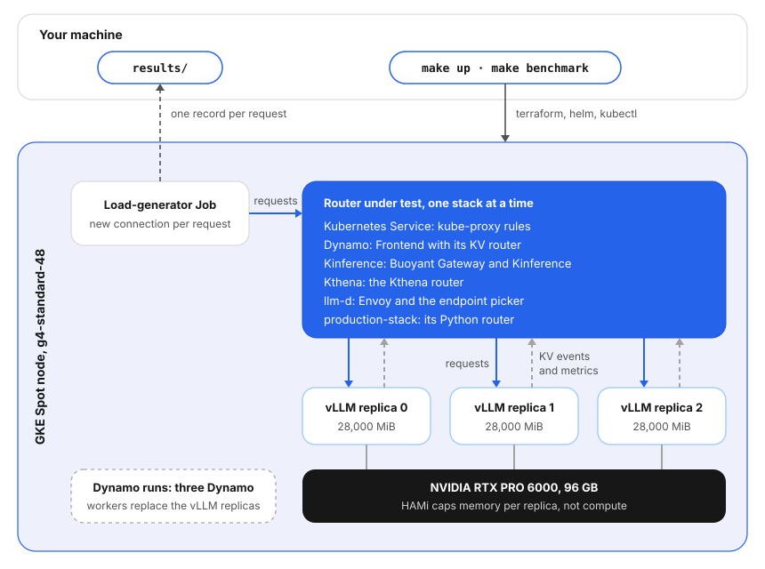

<h1 align="center">Inference routing benchmark</h1>

<p align="center">
  Code to rerun the benchmark from <a href="https://todea.co.kr/en/blog/inference-routing-benchmark"><i>Inference Routing on Kubernetes: Six Options Benchmarked</i></a>.
</p>

Three vLLM replicas of Qwen2.5-7B-Instruct share one NVIDIA RTX PRO 6000 through HAMi, on a GKE Spot node. The same workloads go through a Kubernetes Service, NVIDIA Dynamo, Kinference, Kthena, llm-d and vLLM production-stack, one at a time.

## Architecture



## Requirements

- A GCP project with quota for one Spot `g4-standard-48` (RTX PRO 6000)
- `make`, `terraform`, `gcloud` with `gke-gcloud-auth-plugin`, `kubectl`, `helm`, `jq`, `git`, `python3`

No registry login or Hugging Face token needed.

## Run

```bash
gcloud auth login && gcloud auth application-default login
cp cluster/terraform.tfvars.example cluster/terraform.tfvars   # set project_id
make up          # cluster, GPU driver, NVIDIA toolkit, HAMi
make token       # keeps kubectl working after the gcloud login expires
make benchmark   # every stack, 5 repetitions, ~2 days
make down
```

Results go to `results/compare/repeats.md`. Compare them with `published/repeats.md`, the numbers in the article.

`make benchmark` picks up where it stopped if you run it again, and waits out Spot reclaims. `make quick` is a one-hour check with three stacks.

## Versions

| Component | Version |
| --- | --- |
| GKE | 1.36.5, rapid channel |
| NVIDIA GPU Operator | v25.10.0, driver and device plugin disabled |
| HAMi | 2.10.0 |
| vLLM | v0.31.0 |
| NVIDIA Dynamo | 1.6.2 |
| Kinference | 0.1.0-alpha.7, Buoyant Gateway 0.1.0-alpha.6 |
| Kthena | v1.1.0 |
| llm-d router | v1.0.0 |
| vLLM production-stack | 0.1.14 |

## Notes

- The original runs installed Kinference and Buoyant Gateway with `helm --devel`. Here they're pinned to the versions that ran.
- The original cluster also hosted other demos (monitoring, DRA drivers). `make up` installs only what the benchmark uses.
- The per-request records of the published runs (about 220 MB) aren't included.
- [harness/README.md](harness/README.md) has the stacks, workloads, settings and tuning.
